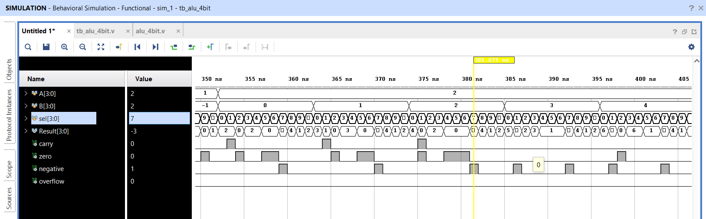
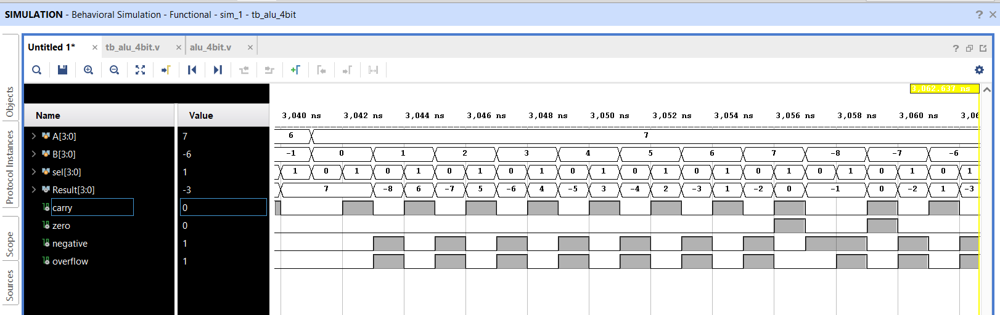

# 4-Bit ALU Design Using Verilog HDL

## Overview

This project implements a 4-bit Arithmetic Logic Unit (ALU) using Verilog HDL. The ALU performs arithmetic, logical, comparison, and shift operations on two 4-bit inputs.

The design is combinational and includes status flags to indicate carry, zero, negative results, and signed arithmetic overflow. A Verilog testbench verifies all 11 supported operations and checks the status flags across all possible 4-bit input combinations.

## Features

- 4-bit input operands and 4-bit result
- 11 arithmetic and logical operations
- Combinational RTL design
- Carry, zero, negative, and overflow flags
- Signed and unsigned comparison operations
- Exhaustive functional verification for all 4-bit operand combinations
- Separate verification of arithmetic and non-arithmetic status flags
- Simulation waveforms for ALU operations and arithmetic flags

## Supported Operations

The operation is selected using the 4-bit `sel` input.

| Operation | `sel` | Description |
|---|---|---|
| ADD | `0000` | Adds A and B |
| SUB | `0001` | Subtracts B from A |
| AND | `0010` | Bitwise AND |
| OR | `0011` | Bitwise OR |
| XOR | `0100` | Bitwise XOR |
| SLT | `0101` | Signed less-than comparison |
| SLTU | `0110` | Unsigned less-than comparison |
| NOT_A | `0111` | Bitwise complement of A |
| SLL | `1000` | Logical left shift of A by 1 bit |
| SRL | `1001` | Logical right shift of A by 1 bit |
| PASS_A | `1010` | Passes A to the output |

For `SLT` and `SLTU`, the result is `0001` when the comparison is true and `0000` otherwise.

Unsupported selector values produce a zero result with the default status flags.

## Status Flags

The ALU provides four status flags.

| Flag | Description |
|---|---|
| Carry (`carry`) | For ADD, indicates carry-out. For SUB, indicates no unsigned borrow. |
| Zero (`zero`) | Set to 1 when the result is `0000`. |
| Negative (`negative`) | Equals the most significant bit of the result, `Result[3]`. |
| Overflow (`overflow`) | Indicates signed overflow during ADD or SUB. Set to 0 for other operations. |

### Carry convention for subtraction

For SUB, `carry = 1` when `A >= B`, indicating that no unsigned borrow occurred. Otherwise, `carry = 0`.

### Signed overflow

For addition, overflow occurs when the operands have the same sign but the result has a different sign.

For subtraction, overflow occurs when the operands have different signs and the result sign differs from the sign of A.

## Verification

The design was verified using a Verilog testbench in Xilinx Vivado.

The testbench checks all 16 × 16 operand combinations for each of the 11 supported operations.

### Functional verification results

| Verification | Passed | Failed |
|---|---:|---:|
| ALU result checks | 2,817 | 0 |
| Status flag checks | 2,817 | 0 |

The result checks include 2,816 operation checks and one invalid-selector result check.

The flag checks include:
- 256 ADD flag cases
- 256 SUB flag cases
- 2,304 non-arithmetic operation flag cases
- One invalid-selector flag case

**Final simulation status: ALL TESTS PASSED**

These results are from the behavioral simulation output.

## Simulation Waveforms

### 1. ALU Operations

The waveform below shows the ALU inputs, operation selector, result, and status flags during functional simulation.



### 2. Arithmetic Flags

The waveform below illustrates arithmetic operations and their associated status flags, including carry, zero, negative, and overflow.



## Repository Structure

```text
4-Bit_ALU_Verilog/
├── src/
│   └── alu_4bit.v
├── testbench/
│   └── tb_alu_4bit.v
├── waveforms/
│   ├── alu_operations.png
│   └── arithmetic_flags.png
└── README.md
```

## Tools Used

- Verilog HDL
- Xilinx Vivado
- Behavioral simulation
- Git and GitHub

## Learning Outcomes

Through this project, I gained practical experience in:

- Designing combinational digital circuits using Verilog HDL
- Implementing arithmetic and logical operations
- Understanding signed and unsigned comparisons
- Generating and verifying arithmetic status flags
- Writing testbenches for exhaustive functional verification
- Analyzing simulation waveforms
- Documenting and maintaining an RTL design project using GitHub

## Future Improvements

Possible extensions include:

- Parameterizing the ALU for wider data widths
- Adding additional arithmetic and bit-manipulation operations
- Integrating the ALU into a processor datapath
- Exploring synthesis results and FPGA resource utilization

## Conclusion

This project demonstrates the design and functional verification of a 4-bit combinational ALU using Verilog HDL. The design supports 11 operations and four status flags, with the testbench reporting zero failures across 2,817 result checks and 2,817 flag checks.

The project provides a foundation for further exploration of RTL design, digital systems, and processor datapath implementation.
